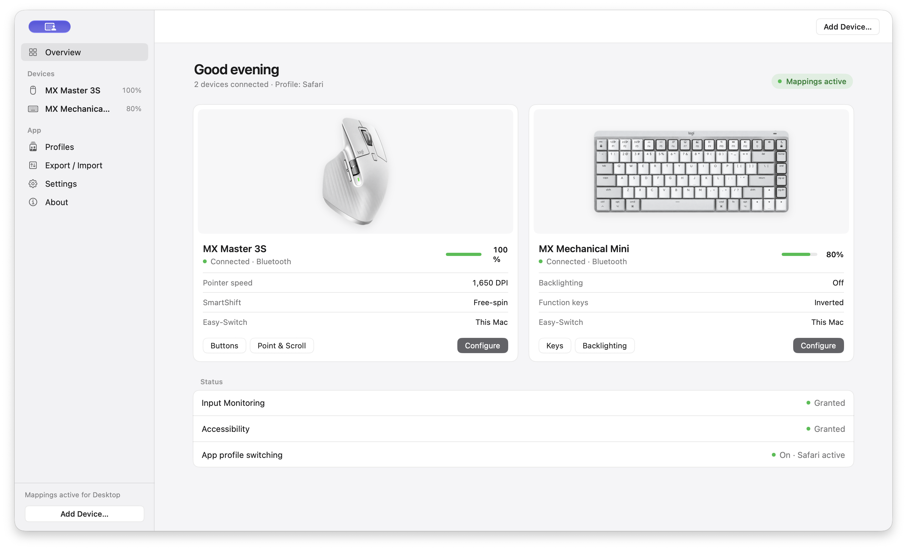
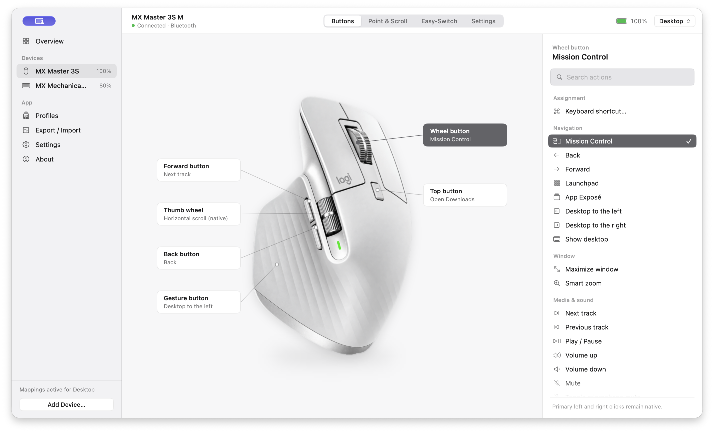
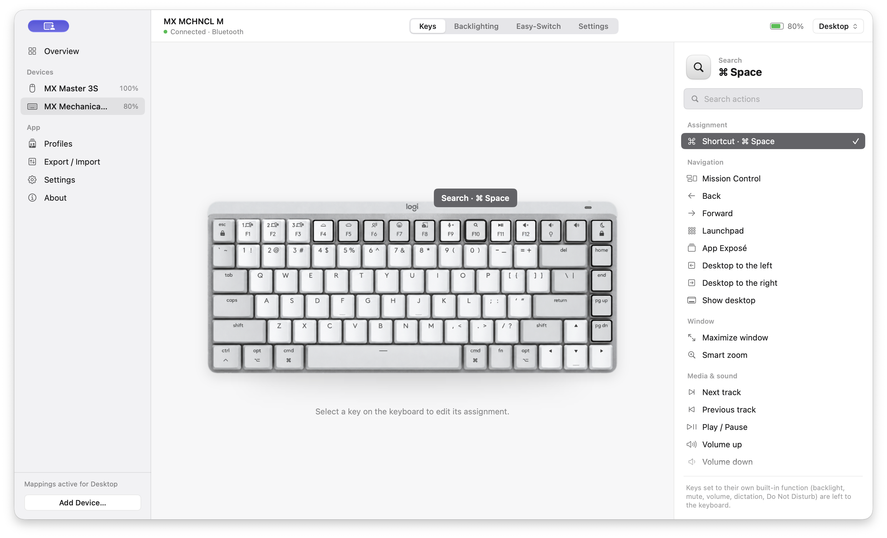

# LogiMXLite

A focused, native macOS app for **exactly two Bluetooth Low Energy devices**:

| Device | USB product ID | Supported connection |
|---|---:|---|
| Logitech MX Master 3S for Mac mouse | `046D:B034` | Already-paired Bluetooth Low Energy |
| Logitech MX Mechanical Mini for Mac keyboard | `046D:B36D` | Already-paired Bluetooth Low Energy |

The packaged build runs on **Apple M-series Macs (arm64) with macOS 15 or later**. It is not a general Logitech device manager: other MX models, Unifying/Bolt receivers, USB-only control, and Flow are outside its scope. A USB cable can charge a device while it continues communicating over Bluetooth; charging status is shown when the device reports it.

LogiMXLite is an independent project by Harith Dilshan. It is not affiliated with Logitech.

The supplied LogiMXLite icon is used for the installed app in Finder and for the Dock while the configuration window is open. The menu bar retains its original monochrome mouse-and-keyboard symbol; the resident device process never decodes the full-size icon at launch.

## Screenshots

The images below are captures of the running macOS app, not design mockups. Battery levels and assignments reflect the test Mac at capture time.



| MX Master 3S buttons | MX Mechanical Mini keys |
|---|---|
|  |  |

## Install

1. Download [LogiMXLite 1.2.5.pkg](https://github.com/h4rithd/LogiMXLite/releases/download/v1.2.5/LogiMXLite-1.2.5.pkg) from the [Releases page](https://github.com/h4rithd/LogiMXLite/releases).
2. Check its SHA-256 if you want to verify the download: `d67ae45f8d710594eef8e34d3706861f53f31a308d82b02b63def18ee9d21ddc`.
3. Open the package and launch **LogiMXLite** from Applications. This locally built package is **unsigned and not notarized**; the app inside is ad-hoc signed. macOS may require **Control-click → Open** on first launch. The package does not establish a verified publisher identity.
4. Pair both supported devices in macOS Bluetooth settings, select this Mac on each Easy-Switch control, and grant **Input Monitoring** and **Accessibility** to LogiMXLite in System Settings → Privacy & Security. Relaunch after granting access.
5. Quit Logi Options+ or another tool that diverts the same controls before enabling mappings. The Settings screen shows permission and conflict status.

By default, the agent shows a menu-bar icon for battery and connection status. In **Settings → General**, turn off **Show menu-bar icon** to run without menu-bar UI or background battery/status polling. Mouse and keyboard mappings remain active. After Configuration closes, the agent restarts once to release memory allocated by the status UI; custom mappings pause briefly during this handoff. Open LogiMXLite again from Applications to change settings or quit the background agent; the Settings page has a **Quit LogiMXLite** button. Launch at Login is a separate option. Settings are stored locally in `~/Library/Application Support/LogiMXLite/` with private file permissions; the menu-bar preference is stored in local macOS preferences.

The resident agent handles device input. Opening Configuration starts a separate, short-lived process of the **same signed app**. The resident instance releases HID ownership first; the configuration process owns the devices while you edit, then exits when its window closes. The resident instance reloads saved settings and reconnects. This handoff briefly pauses custom mappings; avoid holding a gesture while opening or closing Configuration. No helper daemon, cloud service, or second permission identity is installed. See the [process architecture](docs/MEMORY_ARCHITECTURE.md).

## What works

- **Mouse:** assign supported buttons to navigation, window, media, system, or recorded keyboard shortcuts. The thumb button supports click and four-direction gestures. Primary left/right clicks remain native.
- **Pointer and scrolling:** supported DPI values and presets, SmartShift/free-spin controls, vertical and horizontal scroll speed/direction, and optional smoothing. The scroll transform stops when the app quits.
- **Keyboard:** assign supported function-row controls, invert Fn mode, and configure supported backlight mode, brightness, inactivity timeout, and effects.
- **Profiles:** a Desktop configuration with optional per-application overrides. Profiles inherit unchanged controls from Desktop.
- **Device status:** when Configuration is open or the menu-bar icon is enabled, battery percentage, reported charge state, connection state, and available Easy-Switch channel/host readback. Low-battery menu-bar indicators appear at 30% or below when the device is not charging. Headless mode skips firmware, battery, and Easy-Switch status requests, but keeps the HID++ control reads needed for mappings.
- **Portability:** export/import validated JSON settings or preview an import of a local Logi Options+ `settings.db`. Imports do not run scripts and create a local recovery copy before applying changes.

Host names for other Easy-Switch channels appear only when the device provides verified HID++ data. No cloud account is needed. Some Options+ actions and exact physical scroll feel remain unverified; see the [hardware matrix](docs/HARDWARE_MATRIX.md) and [comparison notes](docs/OPTIONS_PLUS_COMPARISON.md).

## CPU and memory measurements

Measured on an **Apple M4 Mac, 24 GB RAM, macOS 27.0.1**, using the 1.2.1 arm64 build. These are local samples, not a claim that LogiMXLite matches Options+ latency or power use. Memory below uses macOS `footprint`/`top` physical footprint; RSS shown by `ps` includes shared mapped pages and is not directly comparable.

A separate 1.2.4 spot check measured **9.1 MB** physical footprint with the menu-bar switch off after a fresh launch and **13 MB** with it on after a configuration cycle. The headless process had no accessible menu bar and sampled **0.0% CPU** in five idle `top` samples. After switching the icon off without restarting, the allocator retained about **13 MB** until relaunch; the configuration process itself exited and freed its memory. Both supported devices were offline during this particular spot check, so these numbers do not establish power use or latency during live input.

In a 1.2.5 check, the existing agent still occupied **20 MB** after the icon was hidden because AppKit and allocator pages remained charged to that long-running process. The new switch-off handoff exited that process and started one headless successor. The successor measured **9.4 MB** physical footprint with zero accessible menu bars; after reopening and closing Configuration, it measured **9.9 MB** with only the agent process remaining. These are short, local observations rather than a long-term memory guarantee. `ps` RSS was higher than `footprint` because the metrics account for mapped/shared/compressed memory differently.

| Workload | CPU | Memory | Method |
|---|---:|---:|---|
| Connected resident device process, Configuration closed | **0.0–0.4%** of one CPU core over 10 samples / ~20 seconds | **16–17 MB** | `top -l 10 -s 2 -pid <pid> -stats pid,cpu,mem`; `footprint -p <pid>` |
| Configuration open on mouse and keyboard pages | Not sampled under sustained interaction | **58–64 MB** for short-lived UI process **plus 16–17 MB** for the resident process | `footprint -p` on both PIDs after visiting each page |
| Configuration closed after visiting both device pages | 0.0–0.4% resident sample above | **17 MB** for the sole remaining process | Child process exit and parent `footprint` verified |
| Device-free high-load benchmark: **100 million** button transitions, gesture movements, and scroll-state updates | 8.77 s user + 0.01 s system CPU over 8.80 s wall time (about **100% of one core** while busy) | **7.3 MiB** maximum RSS for the separate headless benchmark process | `/usr/bin/time -l LogiMXLite --stress-benchmark 100000000` |

The benchmark runs the app's core state machines without Bluetooth I/O, event injection, UI rendering, or physical device traffic. Its small headless-process RSS is **not** the GUI app's memory footprint. The live configuration window showed both BLE devices connected and mappings active; sustained real gestures, battery impact, and long-session behavior still need physical-device testing.

## Build and verify

Requires Xcode command-line tools with Swift 6. Packaging currently produces **arm64 only**.

```sh
swift build                # compile the production targets
make package               # app, unsigned PKG, ZIP, and DMG in dist/
make smoke                 # opens and closes a test configuration window
make benchmark             # repeatable 100-million-cycle core workload
```

The 1.2.5 app bundle passed `codesign --verify --strict`. The installed app was checked with the switch both off and on: the menu-bar item disappeared and returned after closing Configuration, switching off replaced the old agent with one lower-memory headless process, and opening from Applications still worked in headless mode. The 39 Swift tests passed before their source folder was removed at the owner's request because tests are not part of the installed app. This repository now contains production targets only, so `swift test` is no longer an available verification step. `pkgbuild` emits local provenance-metadata warnings and AppleDouble metadata entries; signing and notarization require the maintainer's Apple Developer credentials. See the [security audit](docs/SECURITY_AUDIT_2026-10-20.md) for details.

## Privacy and project notes

There are no accounts, telemetry endpoints, network requests, or external Swift package dependencies in this build. The app uses IOHID for the two already-paired devices and macOS Accessibility for assigned actions. Exported settings may contain your profile names, app IDs, and shortcuts; treat exports as private. Review [privacy](docs/PRIVACY.md), [architecture](docs/ARCHITECTURE.md), [settings format](docs/SETTINGS_FORMAT.md), and [third-party notices](docs/THIRD_PARTY_NOTICES.md).

Device imagery is derived from owner-supplied Logitech screenshots; the project's code license does not grant rights to Logitech marks or imagery. This release is provided as an independent, experimental build, with physical device behavior documented only where tested.
